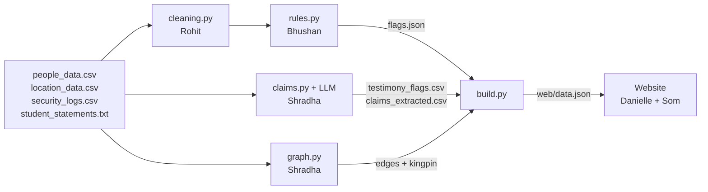

# Boyd Orr Burndown: the dashboard journal

*Som's notes on what we built, how it works, and how to answer questions about it.
GUTS Hackathon 2026, SAS challenge. Branch: `som/map-story-card`.*

---

## 1. The 30-second version

Someone planned to burn down the Boyd Orr. We had three ugly CSV files (people, buildings, security swipes) and a text file of student statements.

We built a pipeline that cleans the data, runs rules over it, uses an LLM to read every statement, and builds a graph of who spent time with whom. It writes everything into one file, `web/data.json`. A website then turns that file into five views:

| View | What it answers |
|---|---|
| **Case** | What happened, and who looks worst |
| **Story** | The case played out step by step on the map, ending in the kingpin reveal |
| **Map** | Where every student was at any minute of the day |
| **Timeline** | Each person's day as bars |
| **Network** | Who met whom, coloured by suspicion |

On top of those: an **interrogation card** for every student (their statement vs their logs, read aloud), and **Trace their day**, which replays one person's whole day and ends with a verdict.

**Our answer:** the kingpin is **Elliott Jones**. He broke no rules and gave no statement, yet he spent a combined 17 h 58 min with 5 of the 12 students who broke a rule. That's more time with rule-breakers than any other student. The likely conspirators are the flagged students he met: **Carolyn Bond, Lee James, Martin Smith, Abdul Murphy and Beth Jones** (5 of the 6 the brief mentions).

> The numbers in this document come from the current `data.json`. If the pipeline is re-run, the site recomputes them, so always quote what's on screen.

---

## 2. What the brief asked, and how we answer it

| The brief says | What we did |
|---|---|
| "Turn the gross CSV files into much prettier representations of data (this is the key part to win)" | Five linked views, all driven by one clock. Nothing is a static chart. |
| "Location data, timeline data or people data (or a mix)" | All three: Map = location, Timeline/Story/Trace = time, Network/avatars = people |
| "Conclude who the conspirators are, and who the kingpin might be" | Reveal button (Network and Story); the Map panel lists likely conspirators |
| "Generalisable" | Nothing is hand-placed. Every view is computed from `data.json`. New data, same dashboard. |
| "Other strange data… points if discovered and explained well" | "Other irregularities" list on the Map, plus our strange-data slide (section 10) |
| "Your best pitch about why someone stands out" | The last Story step lists five reasons, built from the data and read aloud |
| "Six conspirators… a seventh mastermind who met with all of them… whose data looks clean" | We used this as the rule: **conspirators = flagged students the kingpin met** |

---

## 3. Who did what

| Person | Part |
|---|---|
| **Rohit** | Data cleaning (`ingestion/cleaning.py` writes the `*_clean.csv` files) |
| **Bhushan** | Rules engine (`pipeline/rules.py`): out of hours, missed lecture, teleport, identity, age |
| **Shradha** | LLM statement reader (`claims.py`), graph and kingpin (`graph.py`), the builder that writes `data.json` (`build.py`) |
| **Danielle** | Website skeleton (`app.js`, view contract), timeline, first version of the network |
| **Som** | Map, Story, interrogation card, read-aloud, Trace, avatars, the whole visual design system, and integrating everyone's branches |

---

## 4. How the whole thing flows



**Step by step**

1. **Clean** (`cleaning.py`). Tidy column names, uppercase IDs, merge spellings like "QMU" into "Queen Margaret Union", convert times like `2321-0147` into minutes. If a stay ends before it starts, it went past midnight, so 1440 minutes are added to the end time.
2. **Rules** (`rules.py`). Five checks, each producing flags with a severity:
   - **OOH**: inside a building outside its opening hours.
   - **LECTURE**: never in the building where their subject's lecture was.
   - **TELEPORT**: logged in two places at the same time.
   - **IDENTITY**: a student ID in the logs that isn't in the student table.
   - **AGE**: under 18 and inside The Hive (over-18s only).
3. **Read the statements** (`claims.py`). Each statement goes to an LLM (NVIDIA NIM, model `nemotron`, through the OpenAI client). It comes back as structured claims: place, time, activity, society. Those claims are checked against the logs, and a claim with no matching log becomes a TESTIMONY flag. Every reply is cached in `data/llm_cache/`, so the LLM is called once per student, ever.
4. **Graph** (`graph.py`). Two students get a link if they were in the same place at the same time for at least 10 minutes. Link weight = minutes together ÷ how crowded the place usually is, so an hour in a quiet place counts for much more than an hour in a packed lecture hall.
5. **Kingpin** (`graph.py`). Kingpin score = weighted connections ÷ (1 + their own flag score). It's high when you're well connected but clean, which is exactly the brief's description.
6. **Score** (`build.py`). Each student's suspicion score is the sum of their flags (high = 3.5, medium = 2.0, low = 0.8), capped at 10.
7. **Build** (`build.py`). Everything goes into one file, `web/data.json`: buildings, students (stays, claims, flags, score, hair colour, statement), edges, findings, kingpin.
8. **Website** (`web/`). It reads `data.json` once and draws everything in the browser. There's no server code and no build step.

**Why one JSON file in the middle?** The four people on the pipeline and the two on the website never had to wait for each other. The site was built all day against a mock `data.json`, and the real one dropped in later.

---

## 5. How to run it

```bash
# website (from the repo root)
cd web
python -m http.server 8000
# open http://localhost:8000
```

```bash
# rebuild data.json after a rule or cleaning change (free: uses the cached LLM replies)
python ingestion/cleaning.py
python pipeline/rules.py
cd pipeline && python build.py
```

```bash
# regenerate the avatars (only if the student list changes)
npm i @dicebear/core@9.4.2 @dicebear/toon-head@9.4.2
node pipeline/avatars.mjs
```

It has to be served by a web server, not opened as a file, because browsers block `fetch('data.json')` on `file://`. Everything is stored in the repo (map image, fonts, d3, avatars, photo), so **it works with no internet**.

---

## 6. The website, screen by screen

All views share one state: `currentTime`, `selectedStudent`, `mode`, `storyStep`, `revealMode`. Moving the clock anywhere moves it everywhere. Clicking a person anywhere opens their card.

### Case (home page)
- Headline: "Someone planned to burn down the Boyd Orr."
- One paragraph with the real numbers: 163 students, 658 log entries, how many stories don't hold up.
- The kingpin's name is a **blurred placeholder** (the text under the blur is literally "Name withheld", so you can't spoil it from the page source). After the reveal it shows the real name in gold, with the evidence.
- Top 3 by score, each with "Open card" and "Trace their day".
- "What stands out": the top 3 findings. Clicking one jumps to the map at that moment.
- **Exhibit A**: a black-and-white photo of the Boyd Orr Building.

### Story ("Play the case")
- The findings in rank order, then a final reveal step.
- Each step moves the clock to the moment, zooms the map to the place, fades everyone who isn't involved, and lists the names as chips.
- The last step pitches why the kingpin stands out, in five data-built sentences (see section 9).
- Controls: Next/Back, arrow keys, clickable dots, Autoplay (7 s a step), and optional read-aloud.

### Map
- A real street map of the University of Glasgow campus with every building at its real coordinates.
- Every student is a face (avatar), placed where the logs say they are at the current minute. Between two stays they walk in a straight line, if the gap is 30 minutes or less.
- **Ring colour** = suspicion score. **Pulsing ring** = flagged.
- **Buildings** turn grey and dashed when closed. Their opening hours are under each name.
- **Dashed "ghosts"** show where a person *said* they were, so you can see the gap between claim and log.
- **Crowds**: up to 9 faces per building, then a "+N" badge that opens a "who's here" list. This fixed people clicking the wrong face.
- **Right panel**: people on campus now, live alerts, a "right now" feed, **Likely conspirators**, **Other irregularities**, options and legend.
- **Moment buttons** across the top jump straight to each finding.
- Zoom and pan: wheel, pinch, drag, plus the + / − / ◎ buttons. Faces grow more slowly than the map so they don't balloon.
- Play button with speeds 1×, 2×, 5× and 10× runs the whole day.

### Timeline (Danielle)
- One row per student, with bars for each logged stay and each claim made in testimony.
- Flags are marked on the rows and can be clicked to open a pop-up explaining the discrepancy.
- Rows can be expanded to view details of the stays, claims, flags, and any stays that are missing times.
- The suspects with the most flags are listed by default in order of suspicion, and the chart can also be expanded to show "clean" non-flagged students.
- Clicking on a student's name will open their interrogation file.

### Network
- One circle per student, ringed in their suspicion colour, with their avatar inside.
- A line means two students were in the same place at the same time. A thicker line means more time together, in a quieter place. A bigger circle means they met more people.
- Legend buttons (High, Medium, Low, Clean, Kingpin) zoom to that group and fade everyone else.
- **Reveal the kingpin**: he turns gold and moves to the centre, his links become dashed gold lines, and students with no link to him fade.
- + / − / fit / full-screen buttons. Full screen keeps the legend and the reveal button.
- To stay readable, only some lines are drawn: the 300 strongest, each scored student's 15 strongest, and every kingpin link. With all 4,965 drawn it was an unreadable hairball.

### Interrogation card (click anyone)
- Avatar, name, subject, score, flag chips.
- **Statement vs logs**. A claim is marked red when the logs cover less than half of it ("No log entry backs this up" or "Logs cover only 20 of 60 min"). A logged visit they never mentioned is also red.
- The LLM's reasoning, if it gave any.
- Buttons: **Show on the map**, **Trace their day**, **Read aloud**.

### Trace their day
- Replays one person's whole day in about 24 seconds. Time between stays plays 5× faster, so the replay doesn't sit on empty gaps.
- Everyone else fades, their trail grows, and the map follows them.
- The panel shows, at each moment, **what the logs say**, **what they said**, and **who was with them**.
- **What others said about them**: sentences in other students' statements that mention their name. A first name only counts if no one else has it.
- It ends with a **verdict** (Likely conspirator, Possible accomplice, Clean on paper but well connected, Probably not involved, or The kingpin) and the reasons.

---

## 7. How we decide who's who

| Group | Rule | Who (current data) |
|---|---|---|
| **Kingpin** | Highest "connected but clean" score from the graph | Elliott Jones |
| **Likely conspirators** | Flagged students the kingpin spent time with | Carolyn Bond, Lee James, Martin Smith, Abdul Murphy, Beth Jones |
| **Other irregularities** | Flagged, but never with the kingpin | Oscar Brown, Alice Patterson, Shaun Yates, Stuart Wands, Paul Butler, Jonny Craig, Eric Parkin |

**Why not just "the top 7 scores"?** The brief says the mastermind met every conspirator. Oscar Brown, Alice Patterson and Shaun Yates have the highest scores, but they **never** meet Elliott Jones. If the top 7 scores were the conspirators, nobody in the data could be the mastermind. So we used the brief's own rule, and the high-score students we can't link to him go in "other irregularities". They're real data problems, just not part of this plot as far as the data shows.

**Score bands** (same everywhere): high ≥ 7, medium ≥ 3, low > 0, clean = 0.

---

## 8. How we arrived at these visuals (the "how did you think of this" answer)

1. **We started from the story, not the chart.** The brief is a mystery, so we asked what a detective would want to see: *where was everyone, when, who with, and does it match what they said?* That gave us map + clock + statement-vs-log card.
2. **The case-file look.** It reads like an investigation, not a corporate dashboard: a big plain-English headline, sentences instead of KPI tiles, "Exhibit A", a blurred name. Dark mode is the default (light mode is one click away), with Montserrat as the only font.
3. **A real map, not dots on a black square.** Our first version placed buildings at their coordinates on a blank background and looked like a scatter plot. Switching to real street tiles made it obviously Glasgow, and people immediately understood it.
4. **Faces instead of dots.** 163 identical dots tell you nothing. Each student gets a cartoon face with **their real hair colour from the dataset**, so the people data becomes visible and memorable ("the one with the mint-green hair"). The suspicion colour is the ring around the face.
5. **One clock for everything.** Time is the main thing in this case, so the clock is shared: move it in Story and the map, the timeline and the header all move together.
6. **Show the lie, not a number.** On the card the red line *is* the evidence: "Claimed the park 22:00 to 02:20, no log entry backs this up." On the map, the dashed ghost is where they *said* they were.
7. **The reveal is a moment.** The kingpin looks clean everywhere else. The network is the only place he stands out, so we made the reveal a deliberate click: he turns gold, moves to the centre, and his links light up.
8. **We fixed what people actually tripped on.** Clicking the wrong person in a crowd led to the "who's here" picker and the +N badges. Big faces when zoomed in led to faces that grow more slowly than the map. The tangle of lines led to drawing only the strongest links.

---

## 9. Defending Story mode (and why it takes the time it does)

**The likely question:** "Story mode has 15 steps at 7 seconds each, which is nearly two minutes. Isn't that slow?"

**Answers:**

- **It isn't meant to be watched end to end in a demo.** It's a presenter tool. Arrow keys, Next/Back and the dots jump to any step, so in the demo we show two or three findings and go straight to the reveal.
- **Every step works on its own.** Each one sets the time, the place and the people, so skipping loses nothing.
- **The strongest findings come first.** Steps are in rank order, so stopping early still shows the best evidence.
- **The motion has a purpose.** The clock glides for about a second and the map zooms for about a second so you see *who arrives and who leaves*. If it jumped instantly, the change would be lost. A slow viewer can pause; a fast presenter can skip.
- **Autoplay stops before the reveal.** The presenter clicks Reveal live, which is the climax.
- **The length is a result, not a design choice.** Steps are built from the findings automatically. When Bhushan's rules added more findings, Story grew from 7 to 15 steps without any code change. That's the "generalisable" part of the brief. Capping it at the top 6 is a one-line change if anyone wants it.
- **Compare it with the alternative.** Reading 658 log rows and 24 statements takes an analyst hours. Story covers the whole case in under two minutes, and in under 30 seconds when presented.
- **The kingpin pitch, in the app's words:**
  - Broke no rules, so no check flags them.
  - Gave no statement, so there is no alibi to check.
  - Spent a combined 17 h 58 min with 5 of the 12 students who broke a rule.
  - That is more time with rule-breakers than any other student.
  - Longest together: 5 h 47 min with Carolyn Bond at St Andrews Building.

  Every number is computed live (`App.kingpinCase()` in `app.js`). The Case page uses the same function, so the two screens always agree.

---

## 10. Strange data we found (for the slides)

| What | Why it matters |
|---|---|
| **Ghost keycard.** 4 swipes for "Jonny Craig" under ID `2912324G`. The real Jonny Craig is `2712324G` and has **no** swipes under his own ID. | Either a typo, or someone using a fake card in his name. The IDENTITY rule caught it. |
| **In two places at once.** Oscar Brown 4 times, plus Alice Patterson and Paul Butler. | One person can't swipe into two buildings at the same time, so it points to shared or cloned cards. |
| **Under 18 in The Hive.** Stuart Wands, aged 17, logged 22:08 to 00:48. | Over-18s venue. |
| **Inside after closing.** Abdul Murphy in the Boyd Orr 22:08 to 22:19, after it closed. | Inside the target building at night. He's also one of the kingpin's contacts. |
| **139 of 163 students gave no statement.** | Most alibis can't be checked, which is why the people who *did* lie matter more. |
| **A misspelt building** ("Queen Maragret Building") and stays that end before they start (past midnight). | Cleaning problems; handled in cleaning and in the site's `normalise()`. |

---

## 11. Tech stack, tools, APIs and references

### Built with

| Tool | Used for | Why this one |
|---|---|---|
| **Plain HTML, CSS and JavaScript** | The whole website | No build step and no framework to set up; anyone can open a file and read it. It loads instantly and works offline. |
| **D3.js v7** (stored in `web/vendor/`) | Network force layout, zoom and pan, map transitions, timeline | The standard tool for custom data visualisation. One library covers graph layout, zooming and animation. |
| **SVG** | Map markers, buildings, network, timeline | Sharp at any zoom, styled with CSS, and each shape is clickable. |
| **Python + pandas + NetworkX** | Pipeline: cleaning, rules, graph, build | The team's common language; NetworkX does graph maths in a few lines. |
| **NVIDIA NIM LLM** (`nemotron`, via the OpenAI Python client) | Reading statements into structured claims | Turns free text into data we can check against the logs. Cached, so it runs once per student. |
| **Web Speech API** (`speechSynthesis`) | Read-aloud on the card and in Story | Built into the browser: free, offline, prefers a British voice. |
| **Native `<dialog>`** | The interrogation card | Built-in focus handling, Esc to close and accessibility at no cost. |
| **Fullscreen API** | Network full screen | Built into the browser. |
| **Montserrat** (font file stored in `web/vendor/`) | All text | Clean geometric sans that is friendly but serious; stored locally so it works offline. |
| **DiceBear "Toon Head"** (`@dicebear/core` 9.4.2, run once by `pipeline/avatars.mjs`) | 163 cartoon faces with the dataset's hair colours | Seeded by student ID so each face never changes. Generated once and saved as SVG files, so there are no network calls during the demo. |

### Outside resources, with credit

| Resource | What for | Licence / credit shown in the app |
|---|---|---|
| **Esri World Street Map** tiles | The campus basemap (`web/campus.jpg`): zoom-17 tiles stitched into one image, dark mode by a CSS colour filter | "Basemap: Esri, HERE, Garmin, © OpenStreetMap contributors" |
| **DiceBear Toon Head** by Johan Melin | Avatars | "ToonHead by Johan Melin, CC BY 4.0, via DiceBear" |
| **Wikimedia Commons**: "University of Glasgow Boyd Orr Building" by Thomas Nugent | Exhibit A photo | "Photo: Thomas Nugent, CC BY-SA 2.0, via Wikimedia Commons" |
| **DiceBear playground** (dicebear.com/playground/?style=toon-head) | Choosing the avatar style | none needed |
| **Napkin.ai** | Pitch deck visuals, prompted with our exact colours and font | none needed |

**Basemap choices we rejected:** CARTO tiles need an API key, and OpenStreetMap's tile servers block scripted downloads under their usage policy. Esri tiles allowed it with attribution.

**Photo choice:** we didn't take a photo from Google Images because most of those are copyrighted. The Wikimedia one is free to use with credit.

### Tools used while building (not part of the app)

| Tool | What for |
|---|---|
| **Claude Code** (AI pair programmer, in VS Code) | Writing and reviewing code with Som, integrating branches, checking the data |
| **Headless Chrome via the DevTools Protocol** (small scripts) | Real-time screenshots and checks after every change (step counts, alert counts, console errors) |
| **graphify** | A map of how the JavaScript files and functions connect, to keep context small |
| **Git / GitHub** | One branch per person, merged into `som/map-story-card`, then a PR to `main` |
| **Python `http.server`** | Local web server |

### The design system (for the slides)

| Token | Hex | Used for |
|---|---|---|
| Background | `#10141B` | Page |
| Panel | `#171C25` | Cards, map panel |
| Line | `#2A3242` | Borders |
| Text / muted | `#E7EAF0` / `#8B94A5` | Words |
| Accent | `#5B8EF0` | Selected, links, open buildings |
| High / medium / low / clean | `#FF5D55` / `#F2A33A` / `#D6C053` / `#737D8E` | Suspicion |
| Kingpin | `#F4C24F` (gold) | Only after the reveal |

---

## 12. Data problems the website had to handle

The site's `App.normalise()` in `app.js` fixes these at load time, so the views never crash. Each one is marked as a job for the pipeline to take over later.

| Problem | Fix |
|---|---|
| Places spelt many ways ("boyd orr building", "QMU", "the Boydy") | Every spelling is mapped to one building ID |
| Stays past midnight end "before" they start | Add 1440 minutes |
| Claims with only a start or only an end time | Assume an hour, and mark it "about" |
| Flag and finding times exist only inside the text ("22:00–02:20", "2208-2219") | Read them out of the text, along with the building name |
| Links to a student ID that doesn't exist (`2912324G`) | Dropped with a console warning (otherwise the network crashes) |
| Link weights above 1 | Scaled to 0..1 |
| LLM reasoning that is raw JSON | Hidden |

---

## 13. Known limitations (say these before a judge does)

- **Overnight meetings are under-counted in the network.** `graph.py` still reads the raw logs, not Rohit's cleaned file, so a meeting that crosses midnight counts as 0 minutes. Fix: point `load_stays()` at `security_logs_clean.csv`.
- **The kingpin choice depends on the graph formula.** A few clean students (Margaret Saunders, for example) were *near* more flagged students. Elliott stands out on *time* spent with the rule-breakers and on his links to the students whose statements fell apart.
- **We found 5 of the 6 conspirators.** The sixth may be someone whose irregularity none of our rules checks for.
- **Two findings say "no building was open" overnight,** but the Library and The Hive are open until 02:00. This is wording in `build.py` to fix.
- **Only 24 statements exist,** so the statement checks only cover those students.
- **Map positions are by building, not by room or exact spot.** People in the same building are fanned out in a spiral so they don't overlap.

---

## 14. Questions we might get, with answers

**"How do you know Elliott Jones is the kingpin?"**
He has zero flags and no statement, so every check passes him. But he spent a combined 17 h 58 min with 5 of the 12 rule-breakers, more than any other student, and his longest meeting was nearly six hours with Carolyn Bond. That's the brief's description exactly: clean data, met the conspirators. Open the Network, click Reveal, and you can see it.

**"Why only 5 conspirators when the brief says 6?"**
We only call someone a conspirator if the data shows both an irregularity *and* time with the kingpin. Five meet both. We'd rather say 5 we can defend than guess a sixth. The others with irregularities are listed separately.

**"Is this generalisable, or did you hard-code the answer?"**
Nothing is hard-coded. Give the pipeline a different day's CSVs and every view, score, list and story step is recomputed. When Bhushan's rules added flags tonight, the site went from 5 scored students to 12 and Story from 7 to 15 steps without any code change.

**"Where's the AI?"**
In one place, deliberately: an LLM turns free-text statements into structured claims (place, time, activity). The rest is rules and graph maths, so each conclusion can be explained.

**"What does a line in the network mean?"**
Two students were in the same building at the same time for at least 10 minutes. A thicker line means longer, in a quieter place, because time together is divided by how busy the place is.

**"Why avatars? Isn't that gimmicky?"**
They show real data: each face has the student's actual hair colour from the people dataset. And 163 identical dots are impossible to follow, whereas faces let you track a person across the map, the network and the card.

**"Why no React or Vue?"**
For a one-day build with six people, a framework is setup and overhead. Plain JavaScript files load instantly, work offline and are readable by everyone on the team. D3 does the hard visual work.

**"Does it work offline?"**
Yes. The map image, fonts, d3, avatars and photo are all in the repo. Only the LLM step needs the internet, and its results are cached.

**"Is it accessible?"**
Keyboard works throughout (Tab, Enter, arrow keys in Story, Esc closes the card). There's light and dark mode, reduced-motion settings are respected, and the card is a native dialog. Colour is never the only signal: scores are also written as numbers, and flags as text.

**"What would you do with more time?"**
Fix the midnight links in `graph.py`; let the presenter cap Story; add a rule for card sharing (the ghost keycard pattern); move the website's data clean-up into the pipeline.

---

## 15. Suggested 2-minute demo

| Time | Do | Say |
|---|---|---|
| 0:00–0:15 | **Case** page | "Someone planned to burn down the Boyd Orr. We checked 163 students against 658 swipes and their statements." |
| 0:15–0:45 | **Story**: show steps 1 and 2, then jump with the dots | "Each step sets the clock, flies the map and highlights who's involved." |
| 0:45–1:10 | Story **reveal** (click Reveal, read-aloud on) | Let the five reasons play. |
| 1:10–1:35 | **Map**: point at the Likely conspirators list, open one card, press Trace their day | "Statement vs logs: red is a lie. Trace replays their day." |
| 1:35–2:00 | **Network**: click Reveal, then the Kingpin legend button | "He's clean on paper, but look who he's connected to." |

**Backup if something breaks:** every view also works by clicking the tabs, and the Case page states the conclusion after the reveal.

---

## 16. Build timeline (Som, 17–18 Oct 2026)

| Time | What |
|---|---|
| 14:06 | Own branch created from `main`, Danielle's web skeleton merged in |
| 14:54 | First campus map: buildings at real coordinates, open/closed by hour |
| 15:15 | Redesign: real street basemap, case-report style |
| 15:32 | Dark/light themes, Montserrat |
| 15:43 | Interrogation card |
| 16:03 | Story mode and read-aloud |
| 17:01 | Trace their day; hair colours on the map |
| 17:27 | Network coloured by suspicion, clickable legend |
| 18:12 | Fixed wrong-card clicks: who's-here picker, suspects list, top 3 on Case |
| 18:36 | Toon-head avatars, live alerts fixed, crowd cap, network zoom and full screen |
| 19:03 | Merged Shradha's pipeline (`llm_part`) |
| 19:25 | Map zoom and pan |
| 22:50 | Network full screen keeps the legend |
| 23:45 | Wording matches the brief (kingpin, conspirators); Exhibit A photo; blurred name |
| 00:00 | Story reveal pitches why the kingpin stands out |
| 00:19 | Merged Bhushan's rules; 12 students scored |
| 00:46 | Map: Likely conspirators + Other irregularities lists |

---

## 17. Words we use

| Word | Meaning |
|---|---|
| **Stay** | One log entry: a student in a building from time A to time B |
| **Claim** | Something a student said in their statement (place + time) |
| **Flag** | A rule that fired for a student (OOH, LECTURE, TELEPORT, IDENTITY, AGE, TESTIMONY) |
| **Score** | Sum of a student's flags, 0 to 10 |
| **Link / edge** | Two students in the same place at the same time, for 10+ minutes |
| **Kingpin** | The organiser: clean data, connected to the conspirators |
| **Likely conspirator** | Flagged and spent time with the kingpin |
| **Other irregularity** | Flagged but never with the kingpin |
| **Finding** | One sentence the pipeline thinks matters, with a time and place; these become the Story steps |
