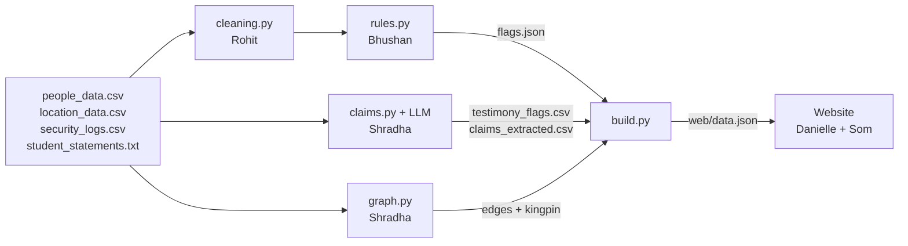

# Boyd Orr Burndown: the dashboard journal

*Som's notes on what we built, how it works, and how to answer questions about it.
GUTS Hackathon 2026, SAS challenge. Branch: `som/map-story-card`.*

> Numbers here come from the current `web/data.json`. If the pipeline is re-run, the site recomputes them, so always quote what's on screen.

---

## 1. The 30-second version

Someone planned to burn down the Boyd Orr. We had three ugly CSVs (people, buildings, security swipes) and a text file of student statements.

A Python pipeline cleans the data, runs rules over it, uses an LLM to read the statements, and builds a graph of who spent time with whom. It writes everything to one file, `web/data.json`. The website turns that file into five linked views (**Case, Story, Map, Timeline, Network**), plus an **interrogation card** for every student and a **Trace their day** replay.

**Our answer:** the kingpin is **Elliott Jones**. He broke no rules and gave no statement, yet he spent a combined **17 h 58 min with 5 of the 12 students who broke a rule**, more than any other student. The likely conspirators are the flagged students he met: **Carolyn Bond, Lee James, Martin Smith, Abdul Murphy and Beth Jones** (5 of the brief's 6).

---

## 2. The brief, point by point

| The brief says | What we did |
|---|---|
| "Turn the gross CSVs into much prettier representations (the key part to win)" | Five linked views on one shared clock; nothing is a static chart |
| "Location, timeline or people data (or a mix)" | All three: Map = location; Timeline, Story and Trace = time; Network and avatars = people |
| "Conclude who the conspirators are, and who the kingpin might be" | Reveal button (Network, Story); Map panel lists likely conspirators |
| "Generalisable" | Every view is computed from `data.json`. New data, same dashboard |
| "Other strange data… points if explained well" | "Other irregularities" list on the Map, plus the strange-data slide (section 9) |
| "Your best pitch about why someone stands out" | The last Story step gives five data-built reasons and reads them aloud |
| "Six conspirators… a mastermind who met all of them… whose data looks clean" | Our rule: **conspirators = flagged students the kingpin met** |

---

## 3. Who did what

| Person | Part |
|---|---|
| **Rohit** | Data cleaning (`ingestion/cleaning.py`, which writes the `*_clean.csv` files) |
| **Bhushan** | Rules engine (`pipeline/rules.py`): OOH, LECTURE, TELEPORT, IDENTITY, AGE |
| **Shradha** | LLM statement reader (`claims.py`), graph and kingpin (`graph.py`), `build.py`, which writes `data.json` |
| **Danielle** | Website skeleton (`app.js` view contract), Timeline (lanes, flag popups, avatars on rows), first network |
| **Som** | Map, Story, interrogation card, read-aloud, Trace, avatars, the visual design system, and merging everyone's branches |

---

## 4. How it flows



1. **Clean.** Tidy column names, uppercase IDs, merge spellings ("QMU" becomes "Queen Margaret Union"), and turn `2321-0147` into minutes. A stay that ends "before" it starts went past midnight, so it gets +1440 minutes.
2. **Rules.** Each rule writes flags with a severity:

   | Rule | Fires when | Severity |
   |---|---|---|
   | OOH | Inside a building outside its opening hours | high |
   | LECTURE | Never in their subject's lecture building | high (low if no lecture is listed for the subject) |
   | TELEPORT | Logged in two places at the same time | high |
   | IDENTITY | A log ID that isn't in the student table | high |
   | AGE | Under 18 inside The Hive (over-18s only) | high |
   | TESTIMONY (`claims.py`) | A claim in their statement with no log to back it | high or medium |

3. **Read the statements.** An LLM (NVIDIA NIM `nemotron`, via the OpenAI Python client) turns each statement into claims: place, time, activity, society. These are checked against the logs. Every reply is cached in `data/llm_cache/`, so the LLM runs once per student, ever.
4. **Graph.** Two students are linked if they were in the same place at the same time for 10+ minutes. Weight = minutes together ÷ how crowded the place usually is, so an hour in a quiet spot outweighs an hour in a lecture hall.
5. **Kingpin.** Score = weighted connections ÷ (1 + own flag score). This is high when someone is well connected but clean, which is the brief's description.
6. **Score.** Sum of a student's flags (high 3.5, medium 2.0, low 0.8), capped at 10.
7. **Build.** Everything goes into `web/data.json`: buildings, students (stays, claims, flags, score, hair colour, statement), edges, findings, kingpin.
8. **Website.** Reads `data.json` once and draws everything in the browser. No server code, no build step.

**Why one JSON file in the middle?** Pipeline and website never waited on each other. The site was built all day against a mock `data.json`, and the real one dropped in later.

---

## 5. How to run it

```bash
cd web && python -m http.server 8000        # open http://localhost:8000
```
```bash
# rebuild data.json (free: reuses the cached LLM replies)
python ingestion/cleaning.py
python pipeline/rules.py
cd pipeline && python build.py
```
```bash
# regenerate avatars (only if the student list changes)
npm i @dicebear/core@9.4.2 @dicebear/toon-head@9.4.2 && node pipeline/avatars.mjs
```

It must be served, not opened as a file, because browsers block `fetch('data.json')` on `file://`. Everything (map image, fonts, d3, avatars, photo) is in the repo, so **it works offline**.

---

## 6. The website, screen by screen

All views share one state: `currentTime`, `selectedStudent`, `mode`, `storyStep`, `revealMode`. Moving the clock anywhere moves it everywhere, and clicking a person anywhere opens their card.

**Case (home).**
- Headline and one paragraph with the real numbers (163 students, 658 log entries, how many stories don't hold up).
- The kingpin's name is a **blurred placeholder**. The hidden text is literally "Name withheld", so nobody can spoil it from the page source. After the reveal it shows the name in gold with the evidence.
- Top 3 by score, each with Open card and Trace their day.
- The top 3 findings; click one to jump to the map.
- **Exhibit A**: a black-and-white photo of the Boyd Orr.

**Story ("Play the case").**
- Findings in rank order, then a reveal step.
- Each step moves the clock, zooms the map to the place, fades everyone else and lists the people as chips.
- The last step gives five reasons the kingpin stands out (section 8).
- Controls: Next/Back, arrow keys, dots, Autoplay (7 s per step), optional read-aloud.

**Map.**
- A real street map of campus; buildings sit at their real coordinates and show their opening hours.
- Every student is a face, placed where the logs put them at the current minute. They walk between stays when the gap is 30 min or less.
- The ring colour is the suspicion band, and a pulsing ring means flagged.
- Closed buildings go grey and dashed. Dashed "ghosts" show where someone *said* they were.
- At most 9 faces per building, then a **+N** badge that opens a "who's here" list (this fixed clicks landing on the wrong face).
- **Right panel:** people on campus, live alerts, a "right now" feed, **Likely conspirators**, **Other irregularities**, options, legend.
- Moment buttons jump to each finding.
- Zoom and pan with wheel, pinch, drag or the + / − / ◎ buttons. Faces grow more slowly than the map.
- Play the whole day at 1×, 2×, 5× or 10×.

**Timeline (Danielle).**
- One lane per student, with their avatar and score. By default it shows the **8 students with a high flag**; "Include clean students" shows everyone.
- **Green bars** are logged stays and **blue bars** are claimed stays. **Red or amber boxes** are high or medium flags: hover for the rule, click for a popup with the details and an "Open interrogation card" button.
- **Click a lane to expand it** into separate lines for stays, claims and flags, with labels. Anything with no time is listed as text underneath.
- Checkboxes for clean students, stays and claims.
- A draggable scrubber, or a click on the axis, moves the shared clock.

**Network.**
- One circle per student with their avatar, ringed in their suspicion colour.
- A line means they were together; thicker means longer, in a quieter place. A bigger circle means they met more people.
- Legend buttons (High, Medium, Low, Clean, Kingpin) zoom to a group and fade the rest.
- **Reveal**: the kingpin turns gold and moves to the centre, his links turn into dashed gold lines, and anyone unlinked fades.
- + / − / fit / full screen. Full screen keeps the legend and the Reveal button.
- Only the 300 strongest links, each scored student's 15 strongest, and every kingpin link are drawn. All 4,965 made a hairball.

**Interrogation card (click anyone).**
- Avatar, score and flag chips.
- **Statement vs logs**: a claim is red when the logs cover less than half of it, and a logged visit they never mentioned is also red.
- LLM reasoning, if it gave any.
- Buttons: Show on the map, Trace their day, Read aloud.

**Trace their day.**
- Replays one person's day in about 24 s, with gaps between stays playing 5× faster. The map follows them and their trail grows.
- The panel shows, moment by moment, what the logs say, what they said, and who was with them.
- It also lists other students' sentences that mention their name.
- It ends with a **verdict** (Likely conspirator, Possible accomplice, Clean on paper but well connected, Probably not involved, or The kingpin) and the reasons.

---

## 7. How we decide who's who

| Group | Rule | Who (current data) |
|---|---|---|
| **Kingpin** | Highest "connected but clean" graph score | Elliott Jones |
| **Likely conspirators** | Flagged students the kingpin spent time with | Carolyn Bond, Lee James, Martin Smith, Abdul Murphy, Beth Jones |
| **Other irregularities** | Flagged, but never with the kingpin | Oscar Brown, Alice Patterson, Shaun Yates, Stuart Wands, Paul Butler, Jonny Craig, Eric Parkin |

**Score bands** (the same on every screen): **high ≥ 7, medium ≥ 3, low > 0, clean = 0.**

| Band | Count | Who |
|---|---|---|
| High | 3 | Oscar Brown 10 (4× TELEPORT), Alice Patterson 7, Shaun Yates 7 |
| Medium | 5 | Beth Jones, Stuart Wands, Paul Butler, Jonny Craig, Abdul Murphy (3.5 each: one high flag) |
| Low | 4 | Carolyn Bond, Martin Smith, Lee James (2.0: one medium TESTIMONY flag); Eric Parkin 0.8 |
| Clean | 151 | Everyone else, including Elliott Jones |

**"Scored" vs "flagged":** 12 students have a score. Only 8 are marked *flagged*, meaning they have at least one **high** flag. That's why the Timeline shows 8 by default.

**Why not "the top 7 scores"?** The brief says the mastermind met every conspirator. Oscar, Alice and Shaun have the top scores but **never** meet Elliott. If they were conspirators, nobody in the data could be the mastermind. So we follow the brief's rule, and the high scorers go under "other irregularities": real data problems, just not part of this plot as far as the data shows.

---

## 8. Defending Story mode's length

**The question:** "15 steps at 7 s each is nearly two minutes. Isn't that slow?"

- **It's a presenter tool, not a video.** Arrow keys, Back/Next and the dots jump anywhere. In the demo we show two findings and go straight to the reveal.
- **Every step works on its own** (time, place and people), so skipping loses nothing. **The strongest steps come first**, so stopping early still shows the best evidence.
- **The motion has a purpose.** The clock glides and the map zooms for about a second each, so you see who arrives and who leaves. Pause if it's too fast; skip if it's too slow.
- **Autoplay stops before the reveal.** The presenter clicks Reveal live.
- **The length comes from the data, not from a design choice.** Steps are built from findings automatically. When Bhushan's rules landed, Story went from 7 to 15 steps without any code change, which shows the "generalisable" point. Capping it is a one-line change.
- **Compared with reading 658 log rows and 24 statements**, it's under two minutes for the whole case, or under 30 s when presented.

**The kingpin pitch, as the app shows and reads it:**
- Broke no rules, so no check flags them.
- Gave no statement, so there is no alibi to check.
- Spent a combined 17 h 58 min with 5 of the 12 students who broke a rule.
- That is more time with rule-breakers than any other student.
- Longest together: 5 h 47 min with Carolyn Bond at St Andrews Building.

All of it is computed live by `App.kingpinCase()` in `app.js`. The Case page uses the same function, so the two always agree.

---

## 9. Strange data we found (for the slides)

| What | Why it matters |
|---|---|
| **Ghost keycard.** 4 swipes for "Jonny Craig" under ID `2912324G`. The real Jonny Craig is `2712324G`, with **no** swipes under his own ID. | A typo, or a fake card in his name. The IDENTITY rule caught it. |
| **In two places at once.** Oscar Brown 4 times; Alice Patterson; Paul Butler. | Points to shared or cloned cards. |
| **Under 18 in The Hive.** Stuart Wands, 17, logged 22:08 to 00:48. | Over-18s venue. |
| **In the Boyd Orr after closing.** Abdul Murphy, 22:08 to 22:19. | Inside the target at night, and one of the kingpin's contacts. |
| **139 of 163 gave no statement.** | Most alibis can't be checked, so the ones that did lie matter more. |
| **Misspelt building** ("Queen Maragret Building"); stays that end before they start. | Cleaning problems, fixed in cleaning and in the site's `normalise()`. |

---

## 10. How we arrived at these visuals

1. **Story first, chart second.** A detective wants to know where everyone was, when, with whom, and whether it matches what they said. That gave us the map, the shared clock and the statement-vs-log card.
2. **Case-file look, not a corporate dashboard.** A plain-English headline, sentences instead of KPI tiles, "Exhibit A", a blurred name. Dark by default with a light toggle, and Montserrat only.
3. **A real map.** Our first version placed buildings on a blank background and looked like a scatter plot. Real street tiles made it obviously Glasgow.
4. **Faces, not dots.** Each face has the student's **real hair colour from the dataset**, so you can follow a person across views. The suspicion colour is the ring.
5. **One clock.** Time is the heart of the case, so every view follows the same clock.
6. **Show the lie.** On the card, the red line *is* the evidence. On the map, the ghost shows where they said they were.
7. **The reveal is a moment.** The kingpin looks clean everywhere except the network, so the reveal is a deliberate click.
8. **We fixed what people tripped on.** Wrong-face clicks led to the picker and the +N badges; huge faces when zoomed led to slower face scaling; the hairball led to drawing only the strongest links.

---

## 11. Tech stack, tools and references

| Tool | Used for | Why |
|---|---|---|
| **Plain HTML, CSS, JavaScript** | The whole site | No build step or framework; loads instantly, works offline, anyone can read it |
| **D3.js v7** (in `web/vendor/`) | Network layout, zoom and pan, transitions, timeline | The standard for custom data visualisation |
| **SVG** | Map markers, network, timeline | Sharp at any zoom, styled with CSS, every shape clickable |
| **Python, pandas, NetworkX** | Pipeline | The team's common language; NetworkX handles the graph maths |
| **NVIDIA NIM LLM** (`nemotron`, OpenAI client) | Statements into structured claims | Free text becomes checkable data; cached, so it runs once |
| **Web Speech API** | Read-aloud | Built into the browser, free, offline, prefers a British voice |
| **Native `<dialog>`, Fullscreen API** | Card, network full screen | Built-in accessibility and focus handling |
| **Montserrat** (in `web/vendor/`) | All text | Clean and friendly; stored locally for offline use |
| **DiceBear Toon Head** 9.4.2 (`pipeline/avatars.mjs`) | 163 faces in the dataset's hair colours | Seeded by ID so faces never change; generated once as SVG files |

| Outside resource | For | Credit shown in the app |
|---|---|---|
| **Esri World Street Map** tiles | Basemap (`web/campus.jpg`: zoom-17 tiles stitched; dark mode via a CSS filter) | "Basemap: Esri, HERE, Garmin, © OpenStreetMap contributors" |
| **DiceBear Toon Head** by Johan Melin | Avatars | "ToonHead by Johan Melin, CC BY 4.0, via DiceBear" |
| **Wikimedia Commons**, Thomas Nugent | Exhibit A photo | "Photo: Thomas Nugent, CC BY-SA 2.0" |
| **Napkin.ai** | Pitch deck visuals, given our colours and font | none |

- **Rejected:** CARTO tiles (they need an API key) and OpenStreetMap tiles (their policy blocks scripted downloads).
- **No Google Images:** those photos are mostly copyrighted, and the Wikimedia one is free with credit.

**Build tools (not in the app):** Claude Code (AI pair programmer in VS Code) for writing, reviewing and merging; headless Chrome via the DevTools Protocol for live screenshots and checks after each change; graphify for a map of how the code connects; Git/GitHub with one branch per person; Python `http.server`.

**Colours (for the slides):**

| Background | Panel | Line | Text / muted | Accent | High / Med / Low / Clean | Kingpin |
|---|---|---|---|---|---|---|
| `#10141B` | `#171C25` | `#2A3242` | `#E7EAF0` / `#8B94A5` | `#5B8EF0` | `#FF5D55` / `#F2A33A` / `#D6C053` / `#737D8E` | `#F4C24F` |

Timeline bars: logged stay `#3F8F5A`, claimed stay `#2783A8`.

---

## 12. Data problems the site handles at load time

`App.normalise()` in `app.js` fixes these so no view crashes. Each one should eventually move into the pipeline.

- Places spelt many ways ("QMU", "the Boydy"): all mapped to one building ID.
- Stays past midnight: +1440 minutes.
- Claims with only a start or an end time: assume an hour, and mark it "about".
- Times that exist only inside text ("22:00–02:20", "2208-2219"): read from the text, along with the building name.
- Links to an unknown ID (`2912324G`): dropped with a warning, because otherwise the network crashes.
- Link weights above 1: scaled to 0..1. LLM reasoning that is raw JSON: hidden.

---

## 13. Known limitations (raise them before a judge does)

- **Overnight meetings are under-counted in the network.** `graph.py` reads the raw `security_logs.csv`, not Rohit's cleaned file, so a meeting across midnight counts as 0 minutes. Fix: point `load_stays()` at `security_logs_clean.csv`.
- **The kingpin depends on the graph formula.** Some clean students (Margaret Saunders, for example) were *near* more flagged students. Elliott stands out on *time* with rule-breakers and on his links to the students whose statements fell apart. (`build.py` now says "5 of the 13 flagged students". The 13 includes the ghost-card ID.)
- **5 of 6 conspirators found.** The sixth may have an irregularity none of our rules checks for.
- **Findings 1 and 3 say "no university building is open"** at night, but the Library and The Hive are open until 02:00. This is wording in `build.py`, and Story reads it aloud.
- **Only 24 statements exist**, so statement checks only cover those students.
- **Positions are per building, not per room.** People in the same building are fanned out in a spiral.

---

## 14. Likely questions

**How do you know it's Elliott Jones?** Zero flags and no statement, so every check passes him. But he spent 17 h 58 min with 5 of the 12 rule-breakers, more than anyone, including 5 h 47 min with Carolyn Bond. Clean data, met the conspirators: exactly the brief. Click Reveal in the Network to see it.

**Why 5, not 6?** We only name someone if the data shows an irregularity *and* time with the kingpin. Five we can defend beats six where we guessed one.

**Is it hard-coded?** No. New CSVs, and every score, list and step is recomputed. When Bhushan's rules landed, scored students went from 5 to 12 and Story from 7 to 15 steps with no code change.

**Where's the AI?** Only where it's needed: the LLM turns free-text statements into structured claims. Everything else is rules and graph maths, so every conclusion can be explained.

**What's a network line?** Same building, same time, 10+ minutes. Thicker means longer and in a quieter place.

**Aren't avatars a gimmick?** They carry real data (each student's hair colour), and they let you follow one person across the map, the network, the timeline and the card. 163 identical dots can't do that.

**Why no React?** A one-day build with six people. Plain JS loads instantly, works offline and everyone can read it, and D3 does the heavy lifting.

**Offline? Accessible?** Yes, everything is in the repo; only the LLM step needs the internet, and it's cached. Keyboard works throughout (Tab, Enter, arrow keys, Esc); there are light and dark themes and reduced motion is respected. Colour is never the only signal: scores are numbers and flags are text.

**With more time?** Fix the midnight links in `graph.py`, let the presenter cap Story, add a card-sharing rule, and move the site's clean-up into the pipeline.

---

## 15. 2-minute demo

| Time | Do | Say |
|---|---|---|
| 0:00–0:15 | **Case** | "Someone planned to burn down the Boyd Orr. We checked 163 students against 658 swipes and their statements." |
| 0:15–0:45 | **Story**: steps 1–2, then jump with the dots | "Each step sets the clock, flies the map and highlights who's involved." |
| 0:45–1:10 | **Reveal**, with read-aloud on | Let the five reasons play. |
| 1:10–1:35 | **Map**: Likely conspirators → a card → Trace their day | "Statement vs logs: red is a lie. Trace replays their day." |
| 1:35–2:00 | **Network**: Reveal, then the Kingpin legend button | "Clean on paper, but look who he's connected to." |

Backup: every tab works on its own, and the Case page states the conclusion after the reveal.

---

## 16. Build timeline (Som, 17–18 Oct 2026)

| Time | What |
|---|---|
| 14:06 | Own branch; Danielle's skeleton merged in |
| 14:54 | First campus map |
| 15:15–15:32 | Real street basemap; dark/light themes; Montserrat |
| 15:43 / 16:03 | Interrogation card / Story and read-aloud |
| 17:01 | Trace their day; hair colours |
| 17:27 | Network by suspicion, clickable legend |
| 18:12 | Who's-here picker, suspects list, top 3 on Case |
| 18:36 | Toon-head avatars, live alerts, crowd cap, network zoom and full screen |
| 19:03 / 19:25 | Shradha's pipeline merged / map zoom and pan |
| 23:45 | Brief's wording; Exhibit A; blurred name |
| 00:00 | Story reveal pitch |
| 00:19–00:41 | Bhushan's rules merged (12 scored); Danielle's timeline merged; conspirators follow the brief |
| 00:46 | Map: Likely conspirators and Other irregularities |

---

## 17. Words we use

| Word | Meaning |
|---|---|
| **Stay** | One log entry: a student in a building from A to B |
| **Claim** | What a student said in their statement (place + time) |
| **Flag** | A rule that fired (OOH, LECTURE, TELEPORT, IDENTITY, AGE, TESTIMONY), with a severity |
| **Score** | Sum of a student's flags, 0–10 |
| **Flagged** | Has at least one high-severity flag |
| **Link** | Same place, same time, 10+ minutes |
| **Kingpin** | The organiser: clean data, connected to the conspirators |
| **Likely conspirator** | Flagged and spent time with the kingpin |
| **Other irregularity** | Flagged, never with the kingpin |
| **Finding** | A sentence the pipeline thinks matters, with a time and place; these become Story steps |
